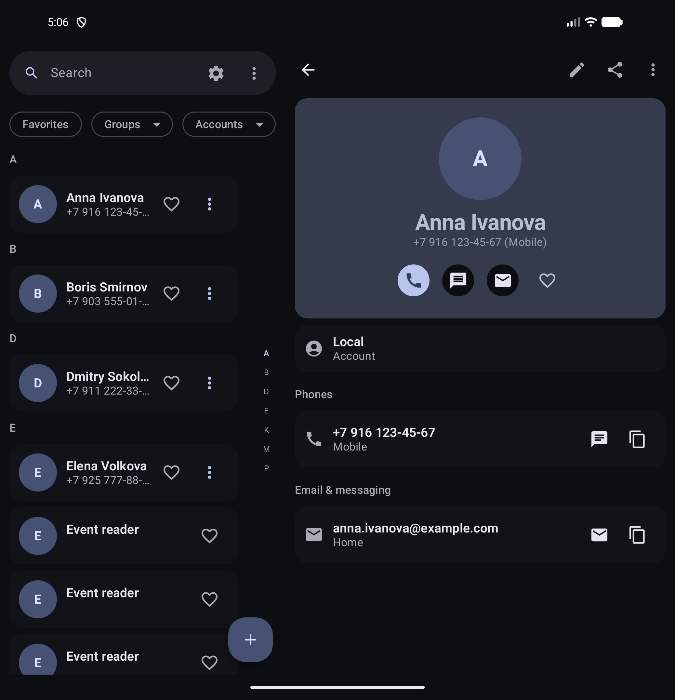
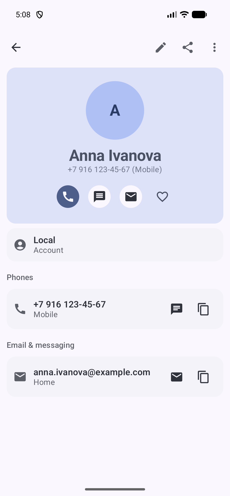

# ContactsApp

A native Android contacts manager built with modern Jetpack libraries and Clean Architecture: browse, search and favorite contacts, view details, create, edit, delete, merge and share them (vCard, plain text or QR code), accept a contact by scanning its QR code, organize them into groups, place calls, and get reminders about birthdays — in English, Russian, Spanish, German, French, and Brazilian Portuguese, on phones, tablets and foldables, in light and dark themes.

| Fold, dark theme | Phone, light theme, details |
|---|---|
|  |  |

## Features

- Contact list: search by name (including structured name components: given/family/middle/prefix/suffix and their phonetics), phone, email, nickname, relation names, company, address, website, note and group names; favorites filter; group (label) filter from the header chip; account filter; alphabetical grouping with a tappable letter index; a header that collapses as you scroll and expands again on a letter jump; pull-to-refresh; phoneless contacts stay visible; multi-select mode (long press or Select all from the header menu) with batch delete (with confirmation and undo via a snackbar), batch vCard sharing and batch add to a group; every row carries an overflow menu with call, SMS, email and copy actions plus a favorites toggle; filtered-out empty states offer one-tap recovery (clear search/filters); import from a .vcf file or by scanning a contact's QR code (both flow into the same preview of duplicates and invalid entries with progress feedback; a QR without a contact is rejected with a clear message), export of the selected contacts to a .vcf file; the list is read page by page, so the first rows show up immediately on a large base
- Contact details: phones, emails, instant messengers, structured addresses (street, city, region, postcode, country), websites, organization (company, title, department), note, birthday, nickname, relations (family, friends, etc.), events (anniversaries and custom dates with labels), the account the contact belongs to and group memberships (labels with account ownership); a hero card holds the photo, the name, the primary phone (the company, when there is no phone) as its subtitle and the call, SMS, email and favorites buttons, while edit and share stay one tap away in the top bar and the name moves up there once the hero scrolls out; call (with confirmation), SMS, email, IM, map, open link and copy actions; "add to calendar" for a birthday and an event (the next occurrence of the date); vCard, plain text and QR code sharing; copy and move to another account
- Contact editor: create, update and delete contacts; account picker for new contacts (local storage or a synced account) that remembers the last used account; existing contacts show their account and only offer groups from it; structured name — a single full-name field or given/family/middle/prefix/suffix components with phonetic variants, toggled with an animated chevron; multi-raw contacts are updated consistently (deterministic target raw contact, group membership rows of all raw contacts reconciled); photo pick from the gallery or the camera with cropping and preview, removal and a round write to the provider; dynamic typed rows for phones, emails, instant messengers, addresses, websites, relations and events — each a single line with a drag handle, a kind menu, the value and a trailing overflow (with custom labels, optional year for dates and a shared date picker), and the form splitting into two columns at expanded width; group membership picker filtered by the contact's account, with inline creation of a new group in that account; nickname field; validation of email, phone, URL and date with a clear message (the values are normalized before they are written: the domain of an email is lower cased, the formatting of a phone is dropped, a site gets the https scheme), an unsaved-changes guard and a warning with a path to merge a likely duplicate
- Groups (labels): a dedicated screen to create, rename, delete and merge groups with member counts and account labels, opened from the navigation rail (the home overflow on phones) or the filter chip menu; members can be removed from the group screen through a picker sheet; group pickers and the group filter distinguish same-name groups from different accounts
- Duplicates: a dedicated screen (the rail, or the home overflow on phones) that finds likely duplicates by normalized phone, email or full name, shows name-only matches with a warning, lets you pick the primary contact and merges all data, labels and the photo into it while keeping favorites; the merge is reversible — the sources stay in the provider and can be unmerged
- Settings (the gear in the search row, or the rail on wide screens): theme override (system/light/dark), dynamic color toggle, show or hide contact photos, app language (system/English/Russian), contact sorting (full name or last name, with matching letter sections), list density (comfortable/compact), favorites first, the default account for new contacts, birthday and event reminders (on/off plus how many days in advance and at what time of day), app lock with a PIN code (numeric pad, auto-submit at the stored length) and an optional biometric unlock, hiding the window in the recent apps list, resetting all settings, and an "About" section with the version and a privacy note. Choice settings are single rows that open a value sheet instead of a dialog
- Privacy: the PIN lock covers the whole app and asks again when the app is genuinely backgrounded; with biometrics enrolled the lock offers the system BiometricPrompt first, and the PIN stays as the fallback (biometric cancellations never consume the PIN attempt budget); the PIN is stored as a PBKDF2-HMAC-SHA256 hash with a random salt, not in clear text; after a few wrong attempts the input is blocked for a while; the window can be hidden from the recent apps list with `FLAG_SECURE`
- Reminders: a daily local notification lists the birthdays and events that are coming up; tapping the notification opens the contact; reminders are restored after reboot and request `POST_NOTIFICATIONS` on Android 13+
- Navigation: Contacts, Groups, Recents, Duplicates and Settings are top-level destinations — a navigation rail on medium and wide windows, overflow entries on phones; Recents lists the contacts you last called or messaged, taken from the device's call and message log; groups and duplicates open as their own list-detail panes, while settings, import and details are capped to a readable column on wide screens
- Home screen: launcher shortcuts (new contact, favorites) and a widget with the favorite contacts
- Favorites are stored as `STARRED` rows in the provider, so they survive a sync; Material You dynamic color; the status/navigation bars follow the app theme; adaptive two-pane layout on wide screens

## Architecture

Multi-module Clean Architecture with a build-enforced dependency rule — `:domain` (pure JVM) ← `:data` (android-library) ← `:app`:

```
ContactsApp/
├── domain/   # pure models, repository interfaces, use cases, ports (+ fast JVM tests)
├── data/     # ContactsContract sources (datasource/read/, datasource/write/), repositories, vCard codec
└── app/      # presentation/, di/, ui/
    ├── presentation/   # screens, ViewModels, UiState (contacts/, details/, editor/, groups/, duplicates/,
    │                   # settings/, reminders/, recents/, import/, widget/, navigation/, intent/;
    │                   # shared helpers in common/: permissions/, call/, share/, calendar/, format/,
    │                   # account/, groups/)
    ├── di/             # Metro dependency graph (needs :data on classpath for codegen)
    └── ui/             # design system: theme tokens + components + adaptive layout helpers
```

- **DI — Metro** (compile-time, no KSP/KAPT) instead of Hilt: smaller generated code, faster builds.
- **Navigation — Navigation 3** (`NavDisplay` + `NavBackStack`) with Material adaptive `ListDetailSceneStrategy` for tablets/foldables, a `NavigationRail` for the top-level destinations from medium width up, and custom slide/fade transition specs.
- **State** — single `UiState` + sealed `Loadable<T>` (Loading/Empty/Content/Error) per screen.
- **vCard** — parsing and building .vcf live in `:data` behind the `VCardCodec` port from `:domain`, so presentation knows nothing about the format and the UI gets finished text (share/export) or contact forms (import); the port's methods are suspend, so a large file never parses or builds on the main thread; photos, categories, grouped fields, quoted-printable values and structured addresses are supported.
- **Background work** — AlarmManager for reminders and a RemoteViews widget: both take repositories from the application graph and run without launching the UI.
- **Static analysis** — Detekt + ktlint applied to every module (`detekt`, `ktlintCheck`).

## Stack

| Library | Version |
|---|---|
| Kotlin / AGP / Gradle | 2.4.21 / 9.5.0 / 9.8.2 |
| Compose BOM / compileSdk / minSdk | 2026.09.00 / 37 / 26 |
| Metro DI | 1.5.0 |
| Navigation3 / Adaptive | 1.2.0 / 1.4.0-alpha03 |
| Coil / DataStore / kotlinx.serialization | 3.6.3 / 1.3.0 / 1.12.0 |
| ZXing core (QR encoding) | 3.5.4 |
| zxing-android-embedded (QR scanning) | 4.3.0 |
| Detekt / ktlint-gradle | 2.0.0-alpha.6 / 14.2.0 |

Android permissions used: `READ_CONTACTS` (list), `WRITE_CONTACTS` (editing and contact mutations), `READ_SYNC_SETTINGS` and `READ_SYNC_STATS` (the sync state shown on the account filter), `CALL_PHONE` (direct calls, with dialer fallback), `POST_NOTIFICATIONS` (birthday and event reminders), `RECEIVE_BOOT_COMPLETED` (restoring reminders after a reboot), `VIBRATE` (haptics on row actions, undo and the editor) and `CAMERA` (scanning a contact QR code). The camera is an optional hardware feature (`android.hardware.camera.any`, `required=false`), so contactless devices can still install.

## Build & verify

```bash
./gradlew :app:assembleDebug          # debug APK
./gradlew :domain:test :data:testDebugUnitTest :app:testDebugUnitTest  # 806 unit tests
./gradlew :app:connectedDebugAndroidTest  # 162 instrumented tests (needs a running emulator)
./gradlew detekt ktlintCheck          # static analysis, all modules
```

`LargeListPerformanceTest` is opt-in (`-Pandroid.testInstrumentationRunnerArguments.contacts.perf=true`); in a normal run its unsatisfied assumption is reported as a failure, so drop it with `-Pandroid.testInstrumentationRunnerArguments.notClass=com.m4isper.contactsapp.data.LargeListPerformanceTest`.
